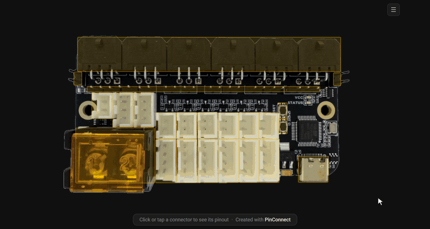

# PinConnect

An interactive pinout generator for PCBs. PinConnect turns a photo of a board into an interactive pinout diagram you can open in a browser or embed in a documentation site.



*A generated pinout for the [Birds' Nest CAN](https://store.isiks.tech/products/birds-nest-CAN) board — hover a connector on the board for its pinout, or open the connector list to browse every connector at once. [Try live examples](https://doctools.isiks.tech/pinconnect/examples/).*

## Quick start

Open **<https://pinconnect.isiks.tech>**, load a photo of your board, draw a box over each connector, label the pins, and press **Generate**. The generator runs in your browser, so your photo and your config never leave it.

To regenerate pinouts as a board changes, or publish them from CI, install the command line tool. It renders the same file from a saved config:

```bash
pip install "git+https://github.com/xbst/PinConnect.git@master"
pinconnect board.toml         # writes board.pinout.html
pinconnect                    # opens the designer locally
```

To embed pinouts in an MkDocs or Zensical site, use [md-iframe](https://github.com/xbst/md-iframe).

## Documentation

**<https://doctools.isiks.tech/pinconnect/>**: getting started, the designer, the command line, embedding and publishing, and the board TOML, connector type and theme references.

Coming from `pinout-gen` or `pinout-embed`? Every old install line and command keeps working; see [Migrating from the old names](https://doctools.isiks.tech/migration/).

## US-based PCB Assembly

PinConnect was initially created to improve our PCB documentation at [Isik's Tech](https://store.isiks.tech/), and decided to open-source it after realizing others could find it useful too.

We also moved to in-house PCB assembly in early 2025 after struggling to find a reliable and affordable US-based PCB assembler, and we recently launched a new PCB assembly service to help others with PCB assembly as well. We can often match or beat delivered costs from overseas. We have an estimator on our website so you can upload your BOM and get an instant estimate. [For more information, visit IsikPCB.com](https://isikpcb.com/)

## License

This project is licensed under GPL-3.0. See [LICENSE](LICENSE).

If you'd like to support the development of this and other open-source projects, you can donate on [GitHub Sponsors](https://github.com/sponsors/xbst/) or [Patreon](https://patreon.com/isikstech).
