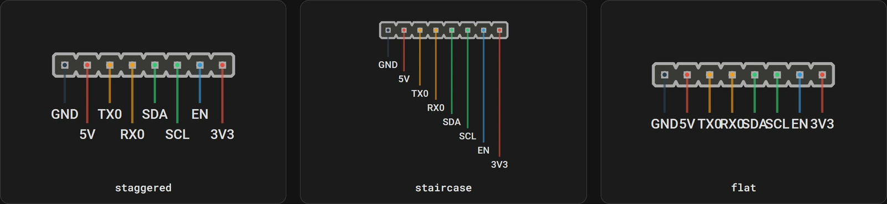
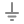
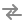
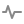
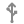
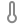
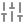
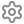

# Board TOML reference

A board config describes one board: the image, its size, and every connector on it. The [designer](../designer.md) produces this file, and `pinout-gen` reads it. You can also write or edit it by hand.

A config has one `[board]` table followed by a `[[connector]]` array, and each connector holds a `[[connector.pin]]` array. A pin header can also hold a [`[[connector.setting]]`](#connectorsetting) array describing where its jumpers go. Example:

```toml
[board]
title = "My Board"
image = "pcb.png"
width = 1920
height = 1080

[[connector]]
id = "CAN1"
name = "CAN In"
type = "MX-F-2R"
x1 = 543
y1 = 422
x2 = 864
y2 = 742

  [[connector.pin]]
  name = "VIN"
  color = "#E74C3C"

  [[connector.pin]]
  name = "GND"
  color = "#2C3E50"

  [[connector.pin]]
  name = "CAN_H"
  color = "#FFBF00"
  row = 2

  [[connector.pin]]
  name = "CAN_L"
  color = "#2ECC71"
  row = 2
```

## `[board]`

| Field | Required | Default | Meaning |
|-------|----------|---------|---------|
| `image` | yes | — | Path to the board image, relative to the config. By default referenced (not embedded) by the output, so keep it next to the generated HTML. Use `pinout-gen -i` to embed it instead. |
| `width` | yes | — | Image width in pixels. |
| `height` | yes | — | Image height in pixels. |
| `title` | no | `"Pinout"` | Page title of the generated HTML (the browser tab) and the board image's alt text. Not drawn on the diagram itself. |
| `connector_dir` | no | `"./connectors"` | Folder holding connector type `.toml` files, relative to the config. Types not found here fall back to the built-in types bundled with the package. |
| `theme` | no | `"default"` | Name of the [theme](themes.md) to apply — colors, fonts, and behaviors of the generated page. |
| `theme_dir` | no | `"./themes"` | Folder holding theme `.toml` files, relative to the config. Names not found here fall back to the built-in themes. |

`width` and `height` set the coordinate space that all connector positions are measured in, so they should match the actual image dimensions.

## `[[connector]]`

One entry per connector on the board.

| Field | Required | Default | Meaning |
|-------|----------|---------|---------|
| `id` | yes | — | Unique identifier for the connector. |
| `name` | yes | — | Label shown on the diagram. |
| `type` | yes | — | Connector type name, matched to `<type>.toml` in `connector_dir` (e.g. `MX-F-2R`). See [connector types](connector-types.md). |
| `x1`, `y1`, `x2`, `y2` | yes | — | Bounding box of the connector on the image, in pixels. `(x1, y1)` and `(x2, y2)` are opposite corners. |
| `orientation` | no | `0` | Rotation of the connector body in degrees: `0`, `90`, `180`, or `270`. |
| `label_style` | no | `"staggered"` | How pin labels are arranged on horizontal connectors: `"staggered"`, `"staircase"`, or `"flat"`. See below. |
| `description` | no | `""` | Longer text shown for the connector (e.g. a tooltip / detail line). |
| `symbol` | no | `""` | Icon shown beside the connector in the list and tooltip when the theme shows symbols: a named icon, a literal glyph, or `"none"`. See below. |

The bounding box places and sizes the connector graphic over the image; `orientation` rotates it so the rendered connector matches what's on the board. The designer sets all of these for you when you drag a box and pick an orientation.

### `label_style`

Controls how pin labels are spaced on horizontal (top/bottom) pinout sides. Has no effect on vertical (left/right) sides, where labels naturally stack without overlapping.

| Value | Behavior |
|-------|-----------|
| `"staggered"` | Odd and even pin labels alternate between two levels. Compact while still avoiding overlap. **(default)** |
| `"staircase"` | Each pin label gets its own level, stepping further from the connector body. Clearest separation, but tall with many pins. |
| `"flat"` | All labels sit at the same level. Most compact, but labels may overlap on dense connectors. |

The same 8-pin header under each style:



```toml
[[connector]]
id = "J1"
name = "Sensor Header"
type = "HDR-254"
x1 = 100
y1 = 200
x2 = 250
y2 = 220
label_style = "flat"
```

### `symbol`

An optional icon shown beside the connector in the list and tooltip, hinting at what it is for. Themes that show symbols (most do by default; a theme can disable them) render it. The value is one of:

- **A named icon** — resolved to a built-in SVG. The 19 built-in names and their aliases are listed below; an alias renders exactly the same icon as its canonical name.
- **A literal glyph** — any other text renders as-is, e.g. `symbol = "⚡"` or an emoji.
- **`"none"`** — no symbol, even where the theme would otherwise show one.

Omitted, a connector shows no symbol (unless the theme opts into style-based fallbacks, which also give a pin header with [jumper settings](#connectorsetting) the `setting` icon). The right symbol usually depends on what the connector is *used for* rather than its shape, so set it explicitly per connector when you use a symbol-showing theme.

#### Built-in icons

Names are matched case-insensitively, and surrounding whitespace is ignored.

| Icon | Name | Aliases |
|------|------|---------|
|  | `power` | — |
|  | `lightning` | `bolt`, `flash`, `zap` |
|  | `battery` | `batt` |
|  | `ground` | `earth`, `gnd` |
|  | `fuse` | — |
|  | `data` | `bus`, `can`, `i2c`, `spi`, `uart` |
|  | `signal` | — |
|  | `usb` | — |
|  | `fan` | — |
|  | `motor` | `servo`, `stepper` |
|  | `heater` | — |
|  | `fire` | `flame` |
|  | `temperature` | `temp`, `thermal`, `thermistor` |
|  | `led` | — |
|  | `button` | — |
|  | `switch` | — |
|  | `setting` | `config`, `dip`, `dipswitch`, `jumper`, `jumpers`, `settings` |
|  | `gear` | `cog`, `cogwheel` |
|  | `speaker` | `buzzer`, `spkr` |

Some icons are deliberate alternatives for the same idea — `lightning` for `power`, `fire` for `heater`, `gear` for `setting` — so pick whichever reads better on your board.

```toml
[[connector]]
id = "FAN0"
name = "Hotend Fan"
type = "XH-F"
x1 = 100
y1 = 200
x2 = 180
y2 = 240
symbol = "fan"
```

## `[[connector.pin]]`

Pins are listed in physical order. The first pin is pin 1.

| Field | Required | Default | Meaning |
|-------|----------|---------|---------|
| `name` | yes | — | Pin label (e.g. `VIN`, `GND`, `CAN_H`). |
| `color` | no | `#888888` | Color of the pin's marker dot and its wire stub. Any CSS color works (`"#E74C3C"`, `"red"`), though the designer writes hex. Pin *label* text is colored by the [theme](themes.md), not by this. |
| `row` | no | `1` | Which row the pin belongs to, for multi-row connectors. Use `2` for the second row and `3` for the third, on the types that have one. |

For single-row connectors, omit `row` (everything defaults to row 1). For two-row types like `MX-F-2R` or `HDR-254-2R`, assign each pin to `row = 1` or `row = 2`; order within each row is the order the pins appear in the file. `STEPSTICK-F` has a third group, the two-pin tower, which takes `row = 3`: its rows are the lower header (`1`), the upper header (`2`) and the tower (`3`). Which side of the body each row sits on, and which way its labels run, comes from the connector type rather than from the board: on the two-row headers and `MX-F-2R`, row 1 labels below the body and row 2 above it.

## `[[connector.setting]]`

A jumper header is read by position rather than by pin: "fit the jumper on 1-2 for 5V". Settings describe those positions. Each setting is one way of fitting the header's jumpers, and the pinout shows the settings as buttons under the connector's drawing: choosing one draws its jumper caps on the header and fades the pins it leaves alone.

Settings work on the pin header types, `HDR-127`, `HDR-200`, `HDR-254` and their two-row `-2R` versions. Any other type with settings is an error.

```toml
[[connector]]
id = "FANV"
name = "Fan voltage"
type = "HDR-254"
x1 = 560
y1 = 60
x2 = 700
y2 = 100

  [[connector.pin]]
  name = "5V"

  [[connector.pin]]
  name = "VFAN"

  [[connector.pin]]
  name = "VIN"

  [[connector.setting]]
  label = "5V"
  jumpers = ["1-2"]

  [[connector.setting]]
  label = "VIN"
  jumpers = ["2-3"]
  default = true
  description = "Fans run at the input voltage."
```

| Field | Required | Default | Meaning |
|-------|----------|---------|---------|
| `label` | yes | — | Text of the setting's button. Unique within its group. |
| `jumpers` | no | `[]` | The jumpers fitted in this setting, each written as two pin numbers joined by a hyphen (`"1-2"`). Leave it out, or empty, for a setting with no jumper fitted, such as "Off". |
| `default` | no | `false` | The setting the pinout opens on, marked "default" on its button. At most one per group. A group without one opens on its first setting. |
| `group` | no | `""` | Settings with the same group are alternatives, and each group is chosen on its own. Leave it out when the whole header is one choice; see [groups](#unrelated-jumpers-on-one-header). |
| `description` | no | `""` | Shown under the buttons while this setting is shown. |

Settings are listed in the order their buttons appear. Every key is checked: a misspelled one (`jumper` for `jumpers`) is an error rather than a setting that silently shows the header open.

### Pin numbers

A jumper names pins by number: their position in the connector's pin list, counted from 1 in the order the `[[connector.pin]]` tables are written, whatever their row. The designer shows these numbers beside each pin.

On a two-row header, write the pins column by column (row 1, then row 2, then row 1 again, and so on). The numbers then match the usual odd/even numbering of a 2xN header: `"1-2"` is the first column, `"3-4"` the second.

A jumper joins two pins that are next to each other: neighbors in the same row, or the two pins of one column on a two-row header. A jumper cap cannot reach further, so any other pair is an error, as is a pin carrying two jumpers in one setting.

### In the pinout

- The drawing opens with every group on its default setting, or its first one. A page printed or viewed without JavaScript shows the same.
- The buttons respond once the tooltip is pinned by clicking or tapping the connector, like its close button. Hovering a button previews it, and clicking selects it.
- The pins the shown jumpers bridge stay at full strength and the others fade, so the eye goes to the jumper position.
- Every time a connector's pinout opens, it starts from the defaults again.
- The jumper caps take the theme's [`jumper` and `jumper-stroke`](themes.md#colorslight--colorsdark) colors.

### Common shapes

Every jumper header is one of a few shapes, or a mix of them. These six are drawn here with one setting chosen each. They are the six headers in [`tools/jumper-gallery/sample.toml`](../../tools/jumper-gallery/sample.toml), which you can open in the designer to see their settings, and the snippets below show their settings with the pins summarized in a comment.


#### On or off

One setting fits the jumper and the other leaves the header open. Either can be the default.

```toml
# pins: 1 CAN_H, 2 120R > L
  [[connector.setting]]
  label = "120 Ω on"
  jumpers = ["1-2"]
  description = "Fit only on the boards at the two ends of the CAN bus."

  [[connector.setting]]
  label = "Off"
  default = true
```

#### A shared middle pin

A three-pin header where the jumper sits on 1-2 or on 2-3, for boot mode selection, a 5V or 3.3V choice, and the like. The two positions overlap on pin 2, which is why they are settings rather than labels on the pins.

```toml
# pins: 1 GND, 2 BOOT0, 3 3V3
  [[connector.setting]]
  label = "Run firmware"
  jumpers = ["1-2"]
  default = true

  [[connector.setting]]
  label = "DFU bootloader"
  jumpers = ["2-3"]
```

#### One of several

A two-row header with one row shared: one jumper picks a pin in the other row. Fan voltage selectors look like this.

```toml
# pins, column by column: 1 VFAN, 2 5V, 3 VFAN, 4 12V, 5 VFAN, 6 VIN
  [[connector.setting]]
  label = "5V"
  jumpers = ["1-2"]

  [[connector.setting]]
  label = "12V"
  jumpers = ["3-4"]

  [[connector.setting]]
  label = "VIN"
  jumpers = ["5-6"]
  default = true
```

#### Combinations

Several jumpers whose combination means something, such as stepper driver microstepping. Each setting lists every jumper it fits, or none.

```toml
# pins, column by column: 1 VDD, 2 MS1, 3 VDD, 4 MS2, 5 VDD, 6 MS3
  [[connector.setting]]
  label = "Full"

  [[connector.setting]]
  label = "1/2"
  jumpers = ["1-2"]

  [[connector.setting]]
  label = "1/4"
  jumpers = ["3-4"]

  [[connector.setting]]
  label = "1/8"
  jumpers = ["1-2", "3-4"]

  [[connector.setting]]
  label = "1/16"
  jumpers = ["1-2", "3-4", "5-6"]
  default = true
```

#### Jumpers that move together

Two or more jumpers that always change together, such as a pair routing the same two signals to one place or another. The jumpers here run along the rows.

```toml
# pins, column by column: 1 CAN_L, 2 CAN_H, 3 L, 4 H, 5 D-, 6 D+
  [[connector.setting]]
  label = "CAN"
  jumpers = ["1-3", "2-4"]
  default = true

  [[connector.setting]]
  label = "USB"
  jumpers = ["3-5", "4-6"]
```

#### Unrelated jumpers on one header

When one header carries several independent jumpers, give each its own `group`. Each group gets its own row of buttons, named after the group, and is chosen on its own. The settings each group opens on are drawn together, so they must not put two jumpers on one pin.

```toml
# pins, column by column: 1 CANH, 2 120R, 3 BOOT0, 4 3V3, 5 VUSB, 6 5V
  [[connector.setting]]
  group = "Termination"
  label = "On"
  jumpers = ["1-2"]

  [[connector.setting]]
  group = "Termination"
  label = "Off"
  default = true

  [[connector.setting]]
  group = "Boot"
  label = "Run"
  default = true

  [[connector.setting]]
  group = "Boot"
  label = "DFU"
  jumpers = ["3-4"]
```

Labels only need to be unique within a group, so both groups here could have an "On".

### Errors

`pinout-gen` stops with one of these, naming the connector and the setting (and the setting's group, when it has one). The designer shows the same message in place of the connector's drawing.

| Message | What to change |
|---------|----------------|
| `unknown key(s): jumper` | A misspelled key. The valid ones are listed in the message. |
| `settings must be written as '[[connector.setting]]'` | Use double brackets: settings are an array of tables, like pins. |
| `missing required key 'label'`, `label must be a nonempty string` | Give every setting a `label`. |
| `jumper '1' must be two pin numbers joined by a hyphen` | Write each jumper as `"1-2"`. |
| `jumper '3-4' names pin 4, but the connector has 3 pins` | Pins are numbered from 1 in the order they are listed; see [pin numbers](#pin-numbers). |
| `pin 2 carries two jumpers` | A setting fits at most one jumper on each pin. |
| `jumper '1-3' joins pins that are not next to each other` | A jumper only bridges neighboring pins. Check the numbering, and on a two-row header the order the pins are written in. |
| `two settings are labeled 'On'` | Labels must differ within a group. |
| `settings 'A' and 'B' are both marked default` | Keep one `default = true` per group. |
| `settings ... are shown together when the pinout opens, and both put a jumper on pin 2` | Each group's default, or first, setting is drawn at once. Change one of them, or put the settings in the same group if they are really alternatives. |
| `jumper settings need a pin header type` | Settings only draw on the `HDR-*` types. |

## Tips

- Connectors that are not physically on the image (for testing a new type, say) still render — just give them a bounding box in an empty area.
- A connector of type `none` draws nothing, so it needs no `[[connector.pin]]` entries at all — give it a name, a bounding box, and usually a `description`, and it becomes a labeled marker over that part of the image. Use it for anything with no pinout to show.
- Comments use `#` and are ignored, so you can annotate the file freely.
- If a `type` has no matching file in `connector_dir` *or* the built-in types, `pinout-gen` stops with a clear error naming the missing type and both folders it searched.
